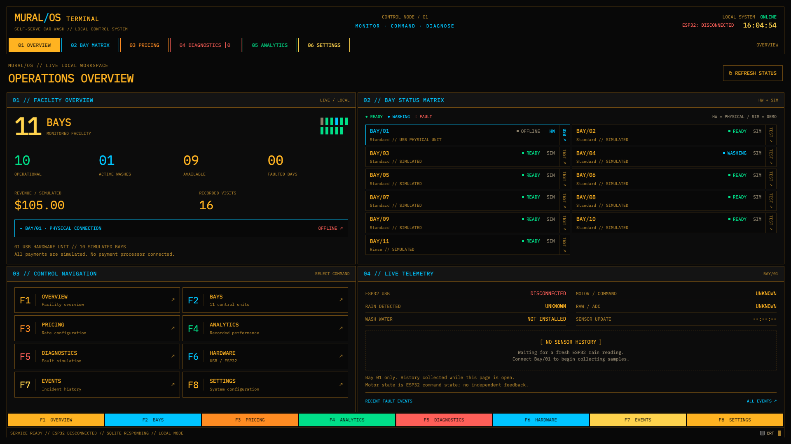
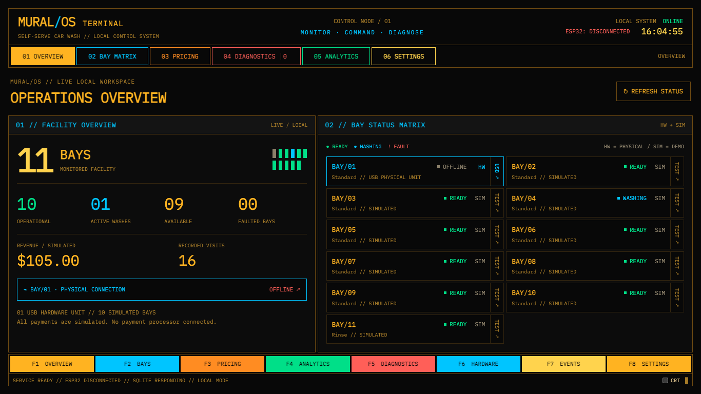
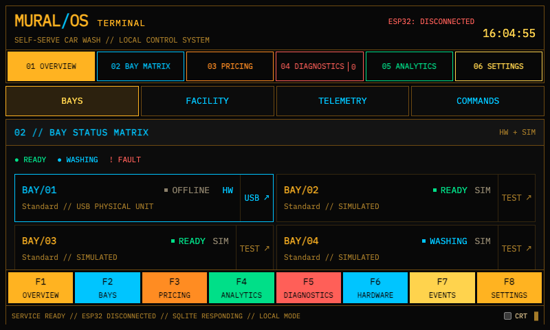
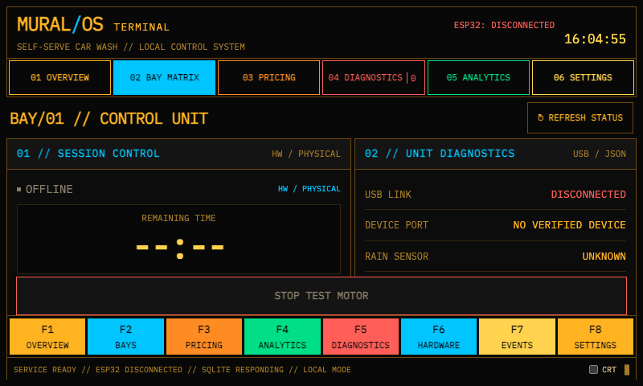
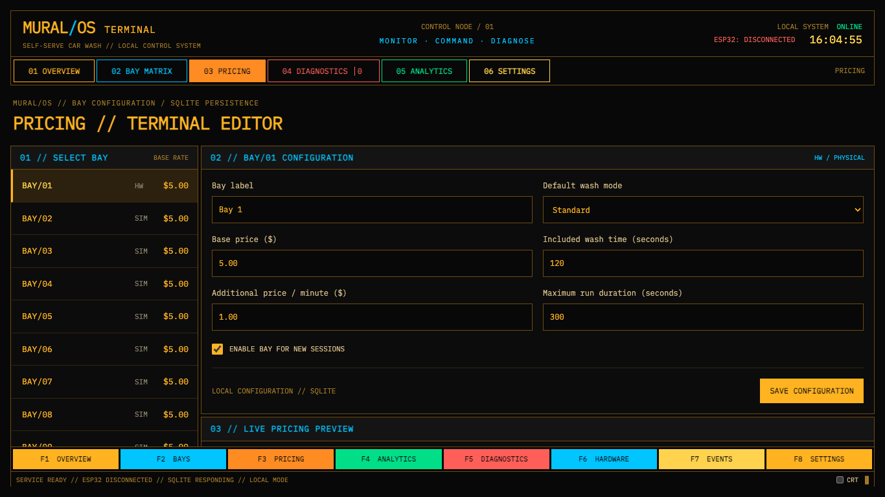
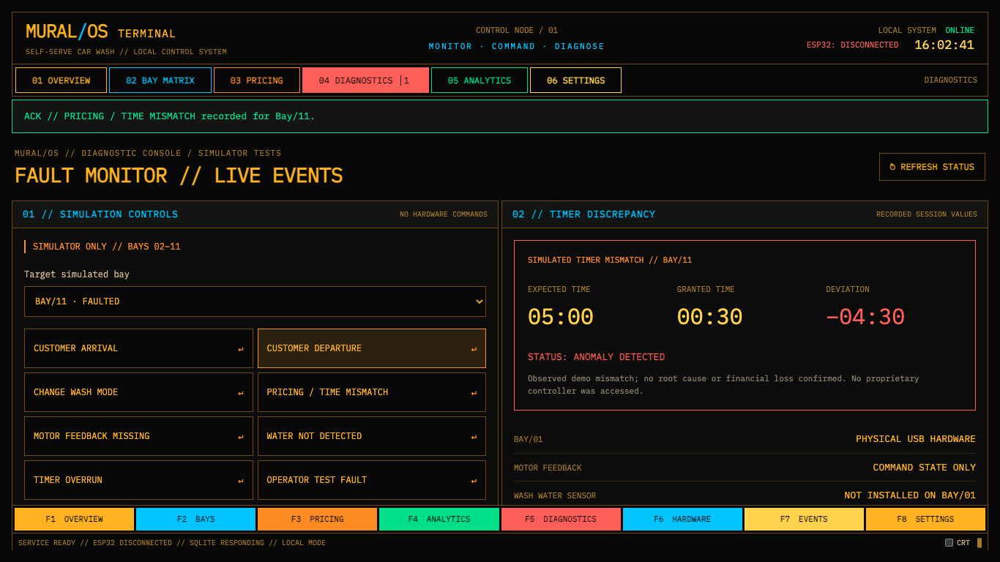

# MURAL/OS redesign verification

Verified November 8, 2026 using local FastAPI, headless Google Chrome and Playwright. Browser mutations used a separate temporary SQLite database. The application's normal database was not used for these checks.

## Changed files

- `pi/static/index.html`: horizontal terminal shell, command navigation, local connection readout, persistent function strip and system line.
- `pi/static/style.css`: central terminal palette, locally bundled IBM Plex Mono, rectangular panels, equipment matrix, responsive workspace, optional scanlines and reduced-motion support.
- `pi/static/app.js`: four-panel operations screen, live bay matrix, bay terminal, single-bay pricing editor, payment preview, diagnostic console, SQLite analytics, received-sample plots and connection-aware polling.
- `pi/README.md`: operation, navigation and data-history documentation.
- This report and the screenshots below.

FastAPI, database schema, serial client, API endpoints and firmware were unchanged. The frontend continues to use the existing pricing, session, fault and hardware contracts. No new runtime dependencies were added.

## Automated checks

| Check | Result |
| --- | --- |
| `python -m unittest discover -s tests -v` from `pi` | All 4 existing tests passed |
| JavaScript syntax (`node --check pi/static/app.js`) | Passed |
| `git diff --check` | Passed |
| Chrome at 1920 × 1080, 1366 × 768, 800 × 480 | All 8 routes rendered; no page-level horizontal overflow or JavaScript errors |
| Bay matrix | All 11 bays; physical/simulator labels and per-bay links |
| Navigation | All 8 function-key links; keyboard shortcuts; shortcuts do not interrupt form editing |
| Pricing | Exactly 1 editor; unsaved input and focus survive polling; payment preview validity; API quote; save and reload persistence |
| Simulator | All 8 scenarios; selected bay retained; recorded mismatch shows expected 05:00, granted 00:30, signed deviation −04:30 |
| Incidents | Severity/resolution filters and resolve action |
| Simulator bay | Start, active timer and stop through existing APIs |
| Disconnected hardware | Unknown readings/countdown and disabled start |
| Touchscreen | Panel tabs, visible fixed STOP, accessible persistent function keys |
| Display preferences | CRT preference persists; reduced-motion disables blinking |
| Service loss | Global state changes to UNVERIFIED; stale connection/readings are not presented as connected/live |

Additional **browser API fixture tests** verified fresh ADC zero readings, timestamp-based sample deduplication, amber/cyan chart traces, stale sample exclusion, available STOP with unknown commanded state, ping/connect/disconnect, motor start/stop request payloads, and countdown behavior. These fixture commands were intercepted in the browser; they did not operate physical hardware. Screenshots below show the ordinary local application, not those hardware fixtures.

## Screenshots

Screenshots use the temporary database's actual simulator state. Hardware is disconnected. The inner workspace scrolls while the function keys remain visible.

### Desktop operations — 1920 × 1080

### Laptop operations — 1366 × 768

### Raspberry Pi operations — 800 × 480

### Raspberry Pi hardware terminal — 800 × 480

### Pricing editor — 1366 × 768

### Recorded simulated pricing discrepancy — 1366 × 768

## Verification limits

- The attachment contained the written brief; no separate reference image was available for direct comparison.
- No connected physical ESP32 was available. USB communication, actual sensor measurements and motor operation still require a physical integration check. No firmware was changed.
- Sensor charts retain up to 120 received fresh samples in the current browser tab. The existing API has no historical sensor endpoint, so history starts empty on reload.
- Revenue-over-time uses the most recent 10 sessions returned per bay. That chart labels its sample limit; report totals use the existing aggregate SQLite endpoint. Utilization retains the backend's recorded-duration / 24-hour estimate.
- The firmware's 300-second cap remains enforced. The illustrative 30-minute anomaly from the brief is represented using the backend's actual safe simulator mismatch values rather than changing timing limits.
